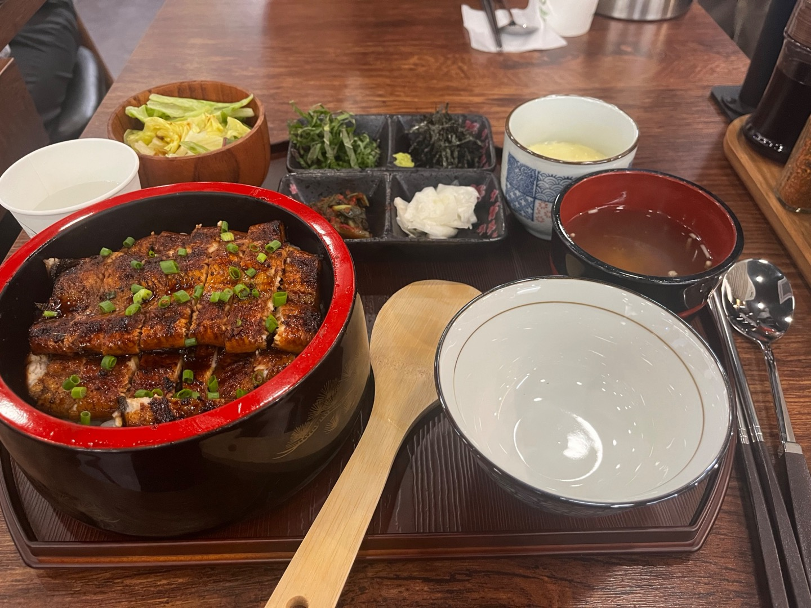

# 🍱 장어덮밥

> [!info] 📋 오늘의 점심
> **📍 위치:** 신대방동 
> **🍜 메뉴:** 장어덮밥 
> **💰 금액:** 23,000원 
> **💬 한줄평:** 새로생겼는데, 장어가 살짝 오버 쿡 가격은 좋다

## 오늘 먹은 것

## 📍 위치
[네이버 지도에서 보기](https://map.naver.com/v5/?c=126.924239,37.491433,15,0,0,0,dh) | [구글 지도에서 보기](https://www.google.com/maps?q=37.491433,126.924239)

