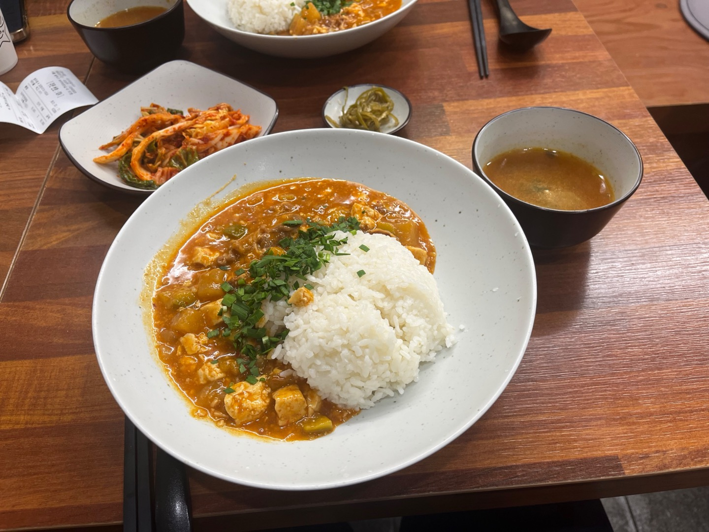

# 🍱 도리장칼국수

> [!info] 📋 오늘의 점심
> **📍 위치:** 신대방동 
> **🍜 메뉴:** 된장덮밥 
> **💰 금액:** 10,000원 
> **💬 한줄평:** 든든한 한끼, 장칼국수도 맛있지만 된장밥도 깔끔하고 좋다

## 오늘 먹은 것

## 📍 위치
[네이버 지도에서 보기](https://map.naver.com/v5/?c=126.9235,37.491589,15,0,0,0,dh) | [구글 지도에서 보기](https://www.google.com/maps?q=37.491589,126.9235)

