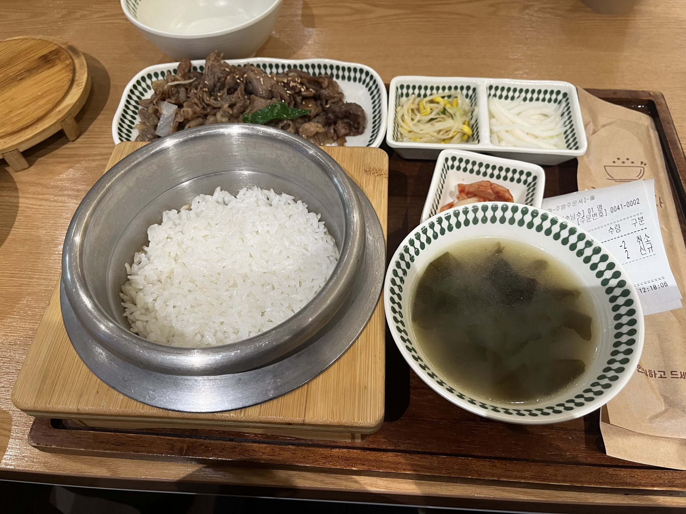
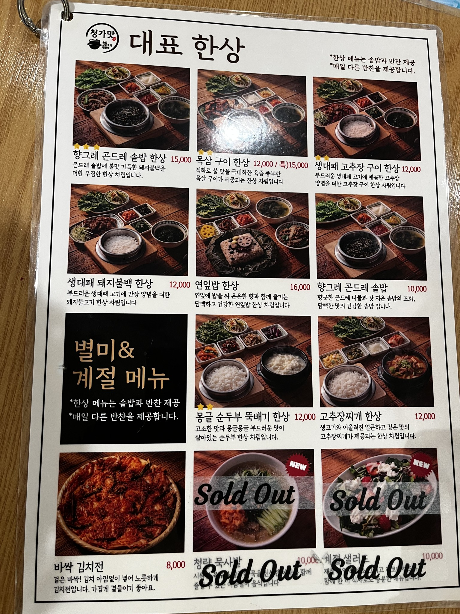

# 🍱 청가맛

> [!info] 📋 오늘의 점심
> **📅 방문일:** 2026-11-06 
> **📍 위치:** 신대방동 
> **🍜 메뉴:** 생대패 돼지불백 한상 
> **💰 참고 가격:** 1인 약 12,000원 
> **도착시간:** 12:14 
> **기다린 시간:** 8분 
> **☁️ 날씨:** 맑음 · 6.9℃ 
> **💬 한줄평:** 깔끔하게 한식 먹기 좋다
> 파절이 셀프바에 있는데 맘에듬

## 오늘 먹은 것

