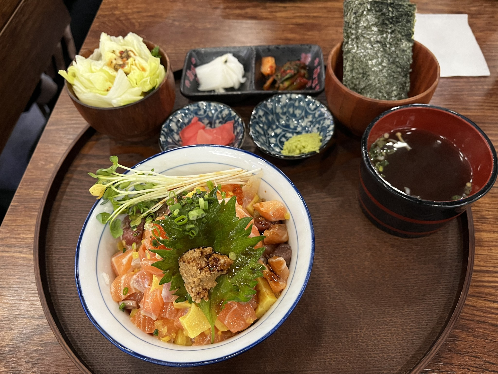
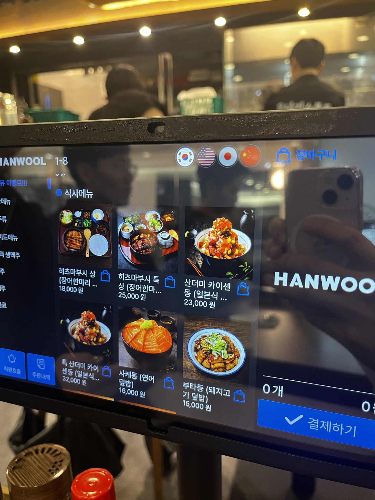

# 🍱 우나기쇼쿠도 보라매점

> [!info] 📋 오늘의 점심
> **📅 방문일:** 2026-11-09 
> **📍 위치:** 아카데미 건물 
> **🍜 메뉴:** 산더미 카이센동 
> **💰 참고 가격:** 1인 약 23,000원 
> **도착시간:** 12:19 
> **기다린 시간:** 7분 
> **☁️ 날씨:** 대체로 맑음 · 9.8℃ 
> **💬 한줄평:** 특이 아니어도 든든하게 먹을수 있다

## 오늘 먹은 것

## 위치
[카카오맵에서 보기](https://place.map.kakao.com/863129730)

