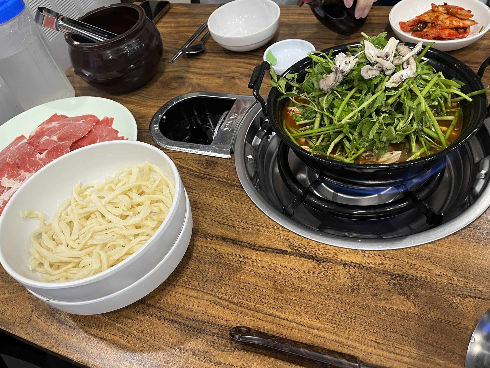

# 🍱 등촌샤브칼국수 보라매점

> [!info] 📋 오늘의 점심
> **📅 방문일:** 2026-11-11 
> **📍 위치:**  
> **🍜 메뉴:** 샤브샤브 
> **💰 참고 가격:** 1인 약 11,000원 
> **☁️ 날씨:** 대체로 맑음 · 12.2℃ 
> **💬 한줄평:** 야채 추가해서 먹으면 딱 맞을듯 가격대비 만족 전도 서비스로 줘서 좋다

## 오늘 먹은 것

## 위치
[카카오맵에서 보기](https://place.map.kakao.com/10373174)

