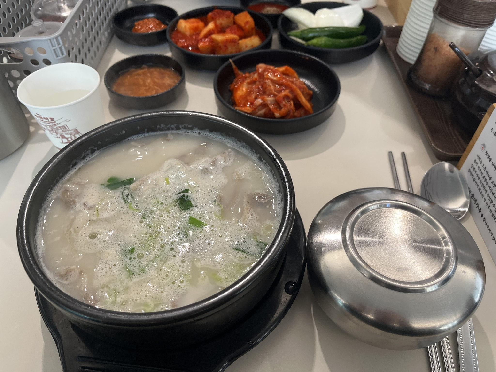
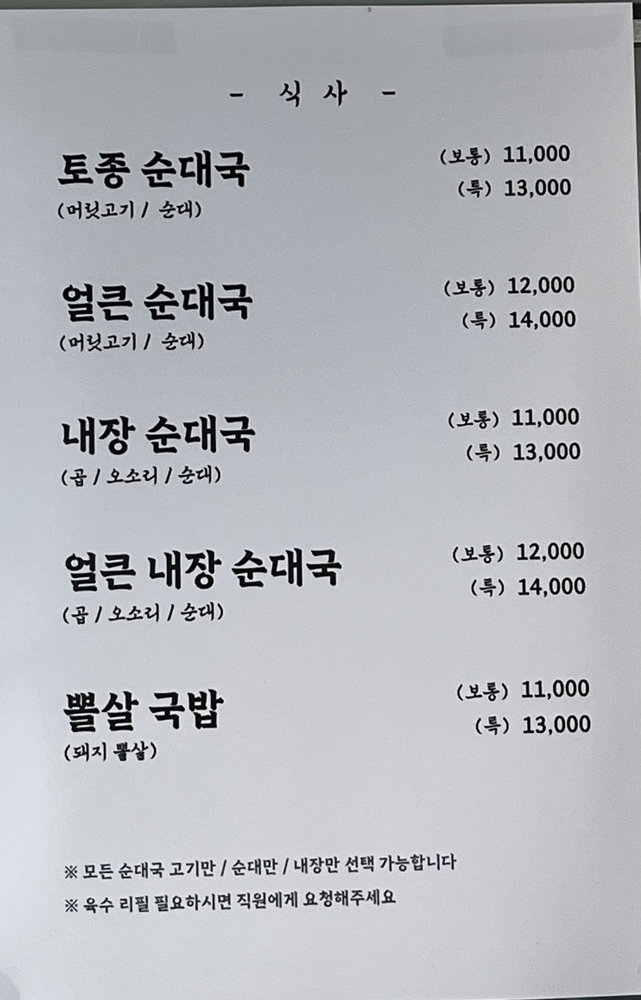

# 🍱 순대가옥 본점

> [!info] 📋 오늘의 점심
> **📅 방문일:** 2026-11-18 
> **📍 위치:**  
> **🍜 메뉴:** 토종 순대국 (특) 
> **💰 참고 가격:** 1인 약 13,000원 
> **도착시간:** 12:17 
> **기다린 시간:** 7분 
> **💬 한줄평:** 국물 깔끔하고 김치도 맛있다
> 다만 특 시켰는데 양이 그렇게 많진 않은 느낌?

## 오늘 먹은 것

## 위치
[카카오맵에서 보기](https://place.map.kakao.com/315066091)

