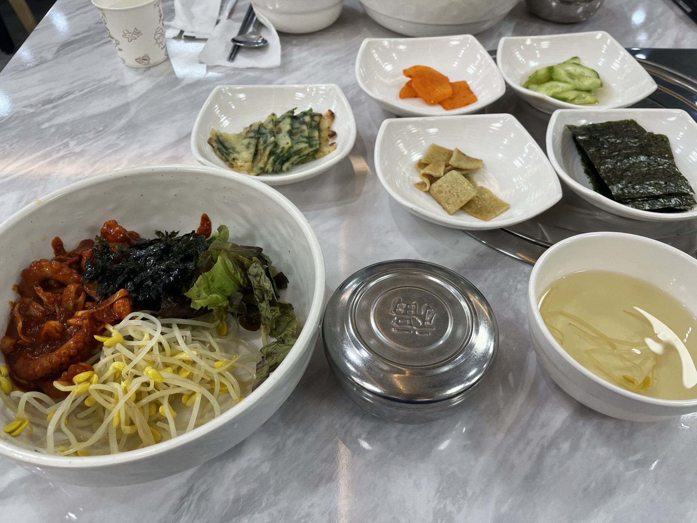

# 🍱 하루낙지

> [!info] 📋 오늘의 점심
> **📅 방문일:** 2026-11-19 
> **📍 위치:**  
> **🍜 메뉴:** 낙지비빔밥 
> **💰 참고 가격:** 1인 약 10,000원 
> **☁️ 날씨:** 맑음 · 3.6℃ 
> **💬 한줄평:** 기본맛이라도 매콤함
> 자극적인 맛이라 살짝 아쉽
> 양념은 좀 덜고 먹는거로

## 오늘 먹은 것

## 위치
[카카오맵에서 보기](https://place.map.kakao.com/2091467106)

