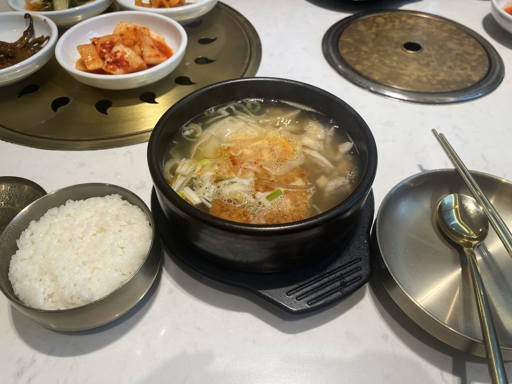

# 🍱 소평가 보라매본점

> [!info] 📋 오늘의 점심
> **📅 방문일:** 2026-11-23 
> **📍 위치:**  
> **🍜 메뉴:** 닭온반 
> **💰 참고 가격:** 1인 약 13,000원 
> **☁️ 날씨:** 이슬비 · 10.3℃ 
> **💬 한줄평:** 국물 깔끔
> 추운날 먹기 좋은 한그릇

## 오늘 먹은 것

## 위치
[카카오맵에서 보기](https://place.map.kakao.com/1473369893)

