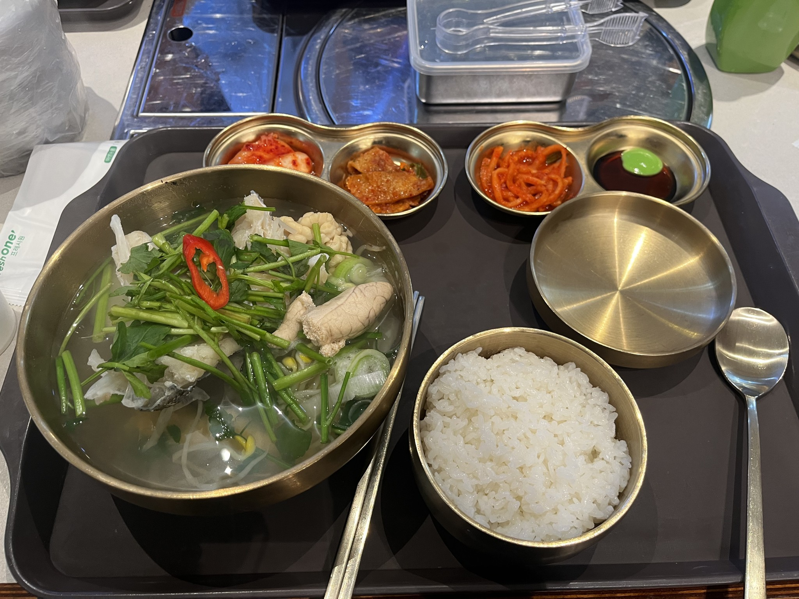
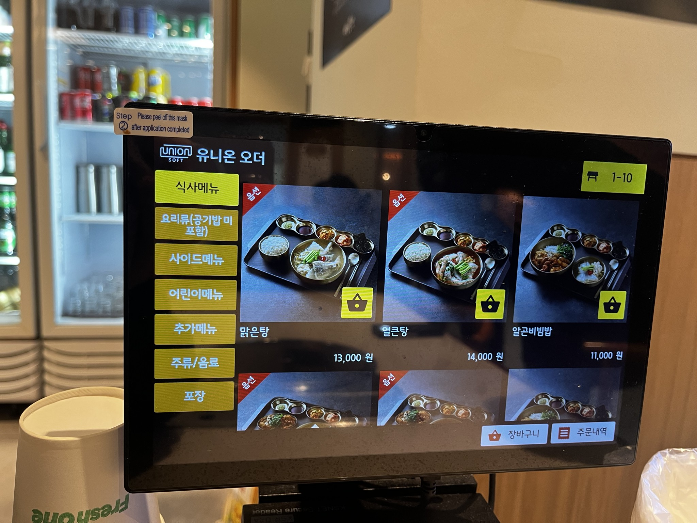

# 🍱 대구일색 보라매공원점

> [!info] 📋 오늘의 점심
> **📅 방문일:** 2026-11-24 
> **📍 위치:**  
> **🍜 메뉴:** 맑은탕 
> **💰 참고 가격:** 1인 약 13,000원 
> **도착시간:** 12:13 
> **기다린 시간:** 5분 
> **☁️ 날씨:** 대체로 맑음 · 1℃ 
> **💬 한줄평:** 따뜻한 국물 온반은 고깃국인데 생선국 먹고 싶으면 추천!

## 오늘 먹은 것

## 위치
[카카오맵에서 보기](https://place.map.kakao.com/2000130160)

