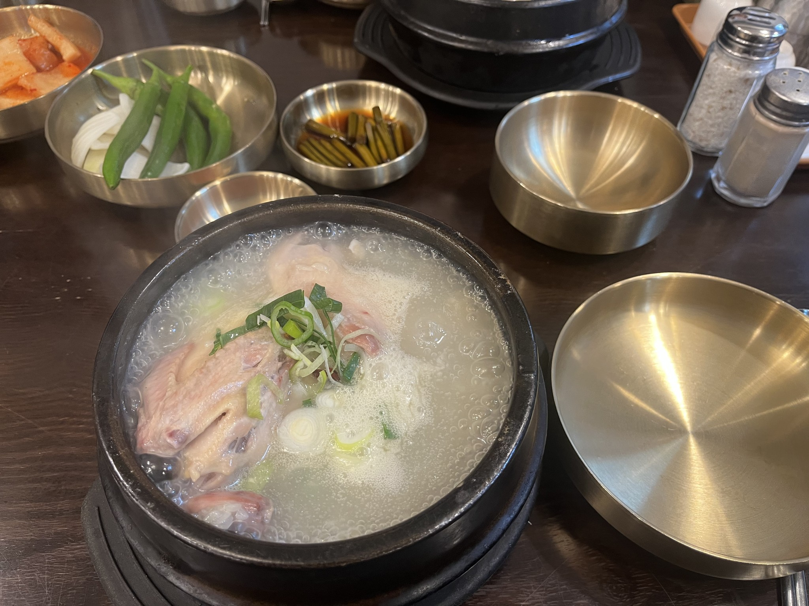
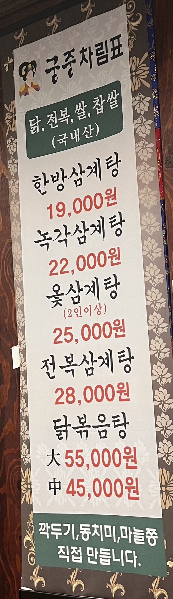

# 🍱 보라매궁중삼계탕

> [!info] 📋 오늘의 점심
> **📅 방문일:** 2026-11-25 
> **📍 위치:**  
> **🍜 메뉴:** 한방삼계탕 
> **💰 참고 가격:** 1인 약 19,000원 
> **도착시간:** 12:13 
> **기다린 시간:** 2분 
> **☁️ 날씨:** 대체로 맑음 · 3℃ 
> **💬 한줄평:** 뜨끈 뜨끈 오랜만에 먹어서 맛있었다
> 오이고추도 신선해서 맛있음

## 오늘 먹은 것

## 위치
[카카오맵에서 보기](https://place.map.kakao.com/8823723)

